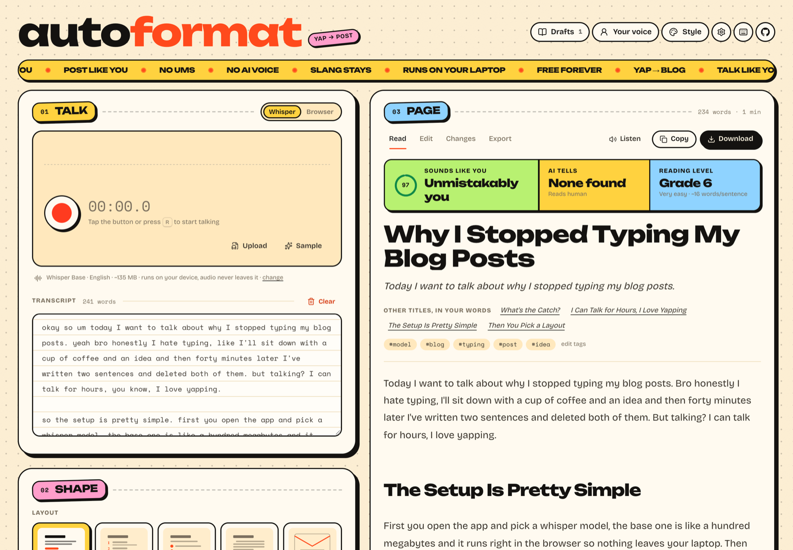
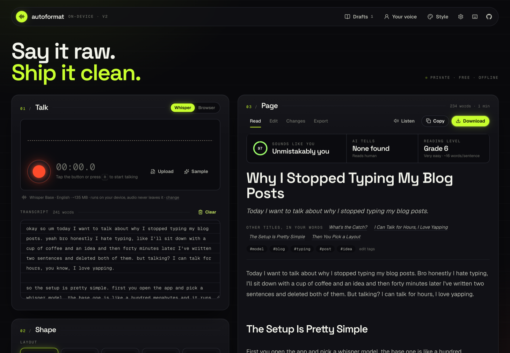
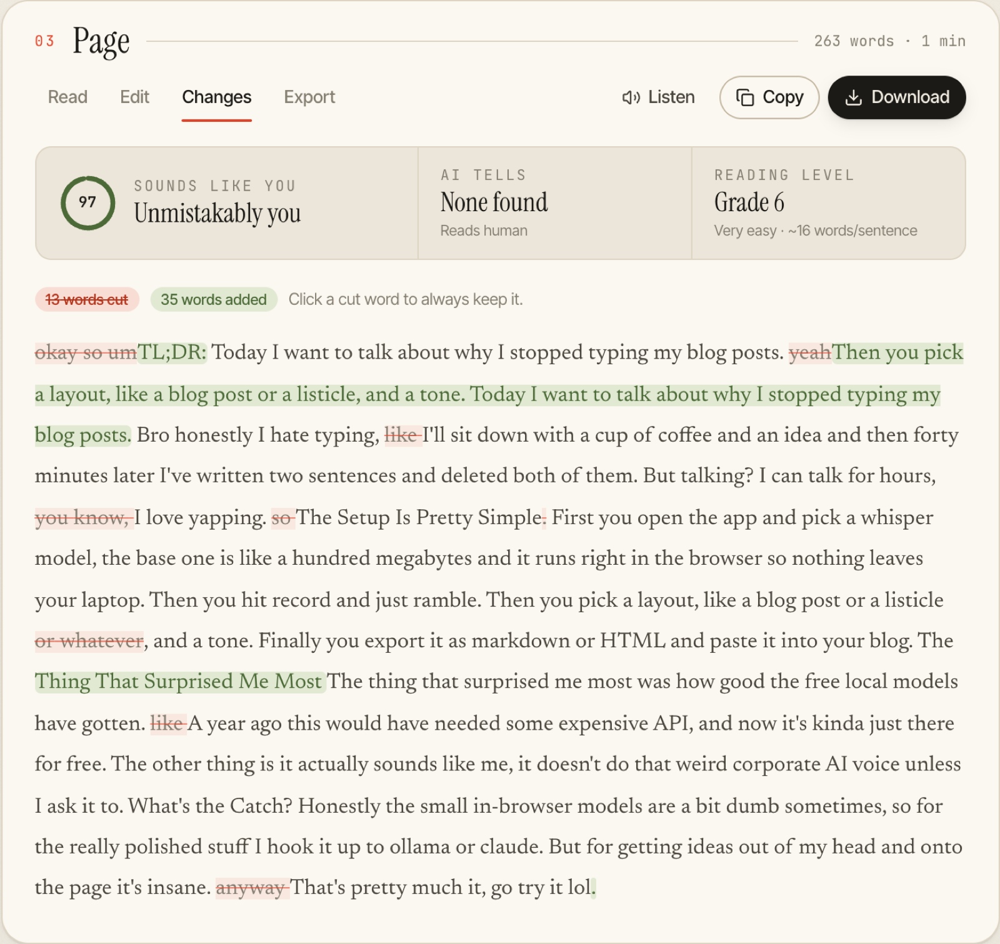
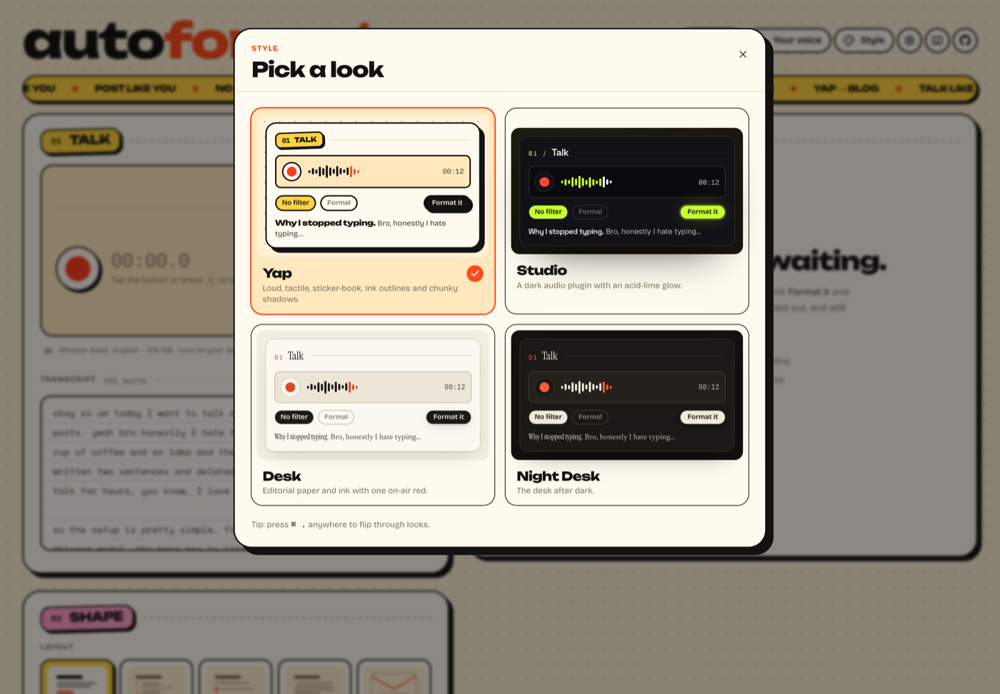
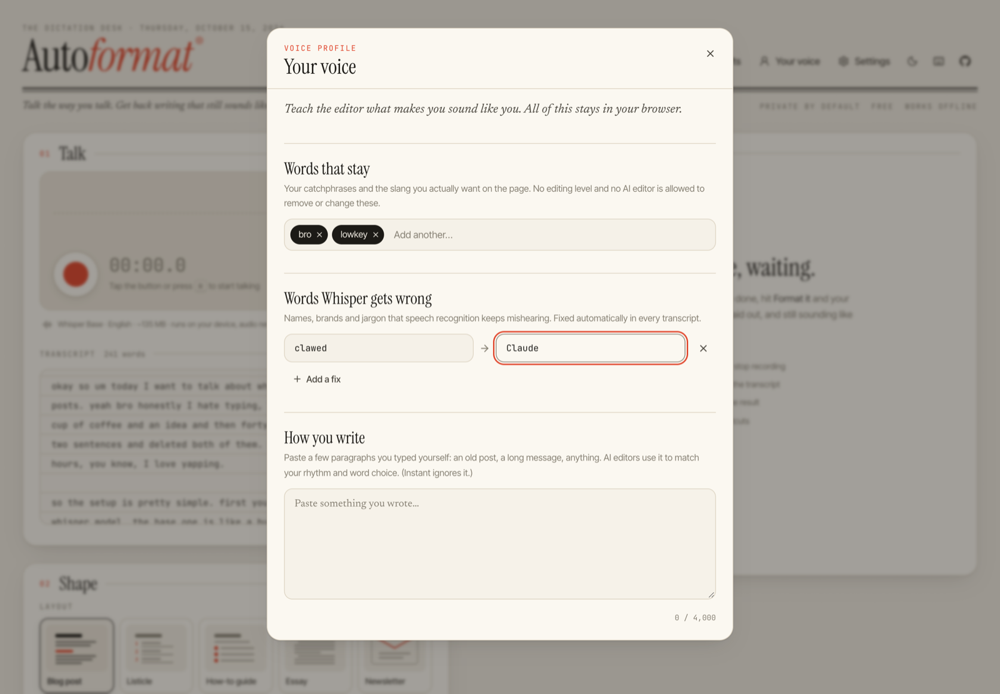

<div align="center">


# AutoFormat

**Talk the way you talk. Get back writing that still sounds like you.**

[](https://github.com/shariqsk/autoformat-/actions/workflows/ci.yml)
[](https://github.com/shariqsk/autoformat-/releases/latest)
[](LICENSE)

[**Download**](#download) · [**Try it in your browser**](https://shariqsk.github.io/autoformat-/) · [Features](#features) · [Run from source](#run-from-source)

</div>

AutoFormat is a dictation desk for people who'd rather talk than type. Hit record and ramble ("yeah bro, so basically…"). Whisper transcribes it **on your device** while you speak. Then pick a layout and how much polish you want, and you get a blog post, listicle, thread or newsletter that reads like you wrote it on a good day, not like a chatbot rewrote you.



<p align="center"> </p>

## Download

| Platform | Download | Notes |
| --- | --- | --- |
| **Windows** 10/11 | [**AutoFormat-Setup.exe**](https://github.com/shariqsk/autoformat-/releases/latest/download/AutoFormat-Setup.exe) | 64-bit installer |
| **macOS** (Apple silicon) | [**AutoFormat-mac-arm64.dmg**](https://github.com/shariqsk/autoformat-/releases/latest/download/AutoFormat-mac-arm64.dmg) | M1 and newer |
| **macOS** (Intel) | [**AutoFormat-mac-x64.dmg**](https://github.com/shariqsk/autoformat-/releases/latest/download/AutoFormat-mac-x64.dmg) | |
| **Linux** | [**AppImage**](https://github.com/shariqsk/autoformat-/releases/latest/download/AutoFormat-linux-x86_64.AppImage) · [**.deb**](https://github.com/shariqsk/autoformat-/releases/latest/download/AutoFormat-linux-amd64.deb) | x64 |
| **Web** | [**shariqsk.github.io/autoformat-**](https://shariqsk.github.io/autoformat-/) | Nothing to install; works offline once loaded, and can be installed as an app from the address bar |

All versions and release notes are on the [releases page](https://github.com/shariqsk/autoformat-/releases).

<details>
<summary><b>First launch: "unidentified developer" / SmartScreen warnings</b></summary>

The apps aren't code-signed yet, so your OS will ask before opening them the first time:

- **Windows:** on the blue SmartScreen screen, click **More info → Run anyway**.
- **macOS:** right-click the app in Applications and choose **Open**, then **Open** again. If macOS says the app is damaged, run `xattr -cr /Applications/AutoFormat.app` in Terminal.
- **Linux (AppImage):** `chmod +x AutoFormat-linux-x86_64.AppImage`, then run it.

The first time you record, AutoFormat downloads the Whisper speech model (~135 MB for the default). After that everything runs offline on your machine.

</details>

---

## Why it's different

Most "AI formatters" hand your words to a model and get back something that sounds like everyone else. AutoFormat is built the other way round. **Your voice is the product**, and the app proves it hasn't been lost:

- **"How much of you" dial.** Every level keeps your words, slang and opinions.
  - **Word for word:** punctuation and paragraphs only.
  - **No filter:** fixes the flow (ums, false starts, "you know") but keeps swearing, jokes and "bro".
  - **Polished:** tighter, nothing crude.
  - **Formal:** "you in a blazer". A handful of word swaps like *gonna → going to*. Same sentences, same contractions.
- **Live proof as you choose.** The dial shows a before/after diff of the messiest sentence from *your own* transcript, so you can see exactly what each level will do.
- **Sounds-like-you score.** After formatting, a voice report measures how much of the page is your own words, in your order, and lists any words the editor introduced.
- **AI-tell detector.** Words like *delve, tapestry, leverage, seamless* and *it's worth noting*, plus em-dash overuse, are highlighted like a marker pen. One click fixes them, and one click undoes the fix. The same list is banned in every prompt.
- **Changes view.** Track changes from what you said to what's on the page. Click any word that was cut to put it on your keep-list for good.
- **Voice profile:**
  - **Words that stay:** your catchphrases survive every level and every model.
  - **Words Whisper gets wrong:** a dictionary for misheard names ("clawed" → "Claude").
  - **How you write:** paste samples of your own writing and AI editors match your rhythm.
- **Small models only name things.** A 1B model can't rewrite you without drifting, so by default the in-browser AI writes only the **title and section headings**. Every sentence stays yours.

## Features

**🎙️ Talk**

- **Private mode (default): live Whisper transcription.** The recording is cut into ~12 s segments at natural pauses and transcribed while you speak, so the text is ready the moment you stop. It runs on your device using WebGPU (or WASM as a fallback).
- **Pick your speech model right in the Talk panel:** *Quick* (65 MB), *Balanced* (135 MB), *Accurate* (510 MB), *Any language* or *Best quality* (1.1 GB). The panel shows whether it's downloaded yet. Pressing record gets the model ready first, so nothing you say is lost while it downloads.
- **Online mode** puts words on screen instantly using your browser's speech service (Chrome, Edge and Safari send that audio to Google, Microsoft or Apple). It's hidden where it can't work, and if the service is unreachable you're switched back to Private mode with an explanation.
- **Tape-deck controls:** live waveform, timecode, pause and resume (<kbd>Space</kbd>), and **Save audio** for every take.
- **Other input:** upload or **drag in** any audio or video file, or drop a `.txt`/`.md`. **Sample** loads a demo ramble.

**📐 Shape**

- **10 layouts:** blog, listicle, how-to, essay, newsletter, Q&A, X/Threads, LinkedIn, notes, journal. Each has a drawn thumbnail.
- **Options:** 4 voice levels; length (*Tight / Balanced / Everything*); title, TL;DR and tag toggles; a free-form *note to the editor*.
- **5 editors:**

| Editor | Runs | Cost | What it does |
| --- | --- | --- | --- |
| **Instant** | In your browser | Free | Rule-based cleanup and layout in milliseconds. Never invents a word; headings come from your own opening clauses ("The Thing That Surprised Me Most"). |
| **In-browser AI** | Your GPU (WebGPU) | Free | Gemma 3 1B / Qwen 2.5 via transformers.js writes the title and headings; your sentences stay untouched. A full-rewrite mode is available as an experiment. |
| **Ollama** | Your machine | Free | Any local model. Full voice-preserving edit. |
| **OpenAI-compatible** | Anywhere | Varies | LM Studio, llama.cpp, Groq, OpenRouter, OpenAI… |
| **Claude** | Anthropic API | Paid | Opus 5.5 / Sonnet 5.5 / Haiku 5.5 with your own key. Best editing quality. |

**📄 Page**

- **Read view:** serif reading layout with an editable title, description and tags, plus **other titles, in your words** offered as one-click swaps.
- **Voice report:** sounds-like-you score, AI tells (with fix and undo), and reading grade.
- **Listen** reads the draft aloud. It's the fastest way to hear whether it still sounds like you.
- **Threads** become per-post cards with character counts and copy buttons.
- **Export:**
  - Markdown with YAML front matter (Astro, Next.js, Hugo, Jekyll)
  - an HTML fragment for any CMS
  - a standalone web page with SEO meta tags
  - plain text
  - JSON
  - an **agent brief**: a ready-to-paste task for Claude Code, Cursor or any coding agent to publish the post on your blog

  Copy from the Read view puts **rich HTML** on the clipboard, so formatting survives a paste into Google Docs, Notion, Medium or WordPress.

**🎨 Four looks** (Style menu, or <kbd>⌘</kbd><kbd>.</kbd> to flip through them)

| Look | Feel |
| --- | --- |
| **Yap** (default) | Loud and tactile: ink outlines, chunky offset shadows, colour-blocked sticker headings, a scrolling ticker. Unbounded + Bricolage Grotesque. |
| **Studio** | A dark audio plugin with an acid-lime glow. Space Grotesk + Geist. |
| **Desk** | Editorial paper and ink with one on-air red. Instrument Serif + Newsreader. |
| **Night Desk** | The desk after dark. |

Themes are more than palettes. Each one sets borders, radii, shadow style, press depth, typography and label treatment through tokens, restyles shared component classes, and has its own masthead.

<p align="center"></p>

**✨ Everything else**

- **Searchable drafts:** the last 50, stored only in your browser.
- **Installable PWA:** the app shell works offline, and models are cached after their first download.
- **Keyboard first:**

| Key | Action |
| --- | --- |
| <kbd>R</kbd> | Record / stop |
| <kbd>Space</kbd> | Pause / resume |
| <kbd>⌘</kbd><kbd>↵</kbd> | Format |
| <kbd>⌘</kbd><kbd>⇧</kbd><kbd>C</kbd> | Copy |
| <kbd>⌘</kbd><kbd>K</kbd> | Drafts |
| <kbd>⌘</kbd><kbd>.</kbd> | Change the look |
| <kbd>?</kbd> | Help |

<p align="center"></p>

## Run from source

```bash
pnpm install
pnpm dev        # http://localhost:5173
```

Click **Sample** to see it work without a microphone, or press <kbd>R</kbd> and start talking. The first recording downloads the Whisper model (~135 MB for Base); after that it's instant and works offline.

### Desktop app

```bash
pnpm desktop           # build and open the Electron app
pnpm dist:desktop      # package an installer for your OS into release/
```

Releases are automated: push a tag like `v1.1.0` and GitHub Actions builds the Windows, macOS and Linux apps and publishes them to the releases page. The download links above always point at the latest release.

### Better rewriting, still free: Ollama

```bash
# install from https://ollama.com, then:
ollama pull qwen2.5:7b     # or llama3.1:8b, gemma3, mistral…
ollama serve
```

Choose the **Ollama** editor, then use **Settings → Ollama → Detect** to pick the model. Ollama accepts requests from `localhost` pages by default. If you host AutoFormat elsewhere, start it with `OLLAMA_ORIGINS="*"`.

### LM Studio, Groq, OpenRouter, OpenAI, Claude

Pick the editor, open **Settings**, choose a preset or paste a base URL and key, and hit **Detect** to list models. Keys live only in your browser's `localStorage`, and requests go straight from your browser to the provider you picked.

## Scripts

| Command | What it does |
| --- | --- |
| `pnpm dev` | Dev server |
| `pnpm build` | Type-check and build the static site (`dist/`), including the service worker |
| `pnpm desktop` / `pnpm dist:desktop` | Run the Electron app / package installers into `release/` |
| `pnpm preview` | Serve the production build |
| `pnpm test` | Unit tests (Vitest) |
| `pnpm typecheck` / `pnpm lint` / `pnpm format` | TypeScript, oxlint, Prettier (with Tailwind class sorting) |

`dist/` is fully static. Every push to `main` deploys it to GitHub Pages; it also works on Netlify, Vercel or Cloudflare Pages (set `BASE_PATH` if it's served from a sub-path).

## How it works

```
 mic ─► AudioWorklet ─► 16 kHz PCM ─► LiveWhisper: cut at quiet points every ~12 s
                                          │
                              Web Worker: Whisper (transformers.js, WebGPU/WASM)
                                          │
              transcript ◄── misheard-word fixes ◄── segments, in order, as you talk
                  │
     ┌────────────┼──────────────────────────────┬───────────────────────────────┐
     ▼            ▼                              ▼                               ▼
  Instant     In-browser AI                 Ollama / OpenAI / Claude         Voice profile
  rules →     rules write the page,         copy-editor prompt + voice       keep-words masked
  layout      model names title/headings    rules + AI-ism ban + samples     from every rule
     └────────────┴──────────────┬───────────────┘
                                 ▼
             FormattedDoc { title, description, tags, body }
                                 │
     voice report (diff vs transcript) · AI-ism marks · changes · exports
```

```
electron/main.mjs              desktop shell (serves the app from app://, grants the mic)
src/
├── App.tsx                    orchestration, shortcuts, theme, toasts
├── components/                Talk / Shape / Page panels, mastheads, dialogs, waveform, layout thumbnails
├── styles/                    themes.css (tokens per look), components.css (semantic classes)
├── hooks/                     useRecorder (worklet + analyser), useTheme, useSpeech, …
├── workers/ml.worker.ts       Whisper + in-browser LLMs
└── lib/
    ├── analysis/              voice match, AI-isms (detect + fix), readability, change diff
    ├── format/                voice levels, rule cleaner, offline layouts, headings planner, prompts, parser
    ├── speech/                live Whisper segmenter, PCM utils, Web Speech wrapper
    ├── llm/                   Ollama, OpenAI-compatible and Claude engines (streaming)
    └── export/                Markdown, HTML, web page, text, JSON, agent brief
```

### Engineering notes

- **Voice-preserving rules.** The offline cleaner works in tiers (filler sounds → verbal tics → crude bits → slang swaps). Protected words are masked with private-use placeholders, so no rule can touch them. Unpunctuated run-ons from browser speech are split at discourse markers.
- **Measuring voice.** The score is the length of the order-preserving word diff between transcript and body prose, divided by the body's word count. Headings, title and TL;DR are excluded, because they're structure built from the speaker's words.
- **Live segmentation.** Each segment ends at the quietest 30 ms window near the 12 s mark, so words aren't split. Silent segments are skipped, and Whisper's stock hallucinations on silence ("Thank you.") are dropped.
- **Small-model reality.**
  - `q4f16` produced gibberish on Apple Metal WebGPU, so chat models load as `q4`.
  - Whisper uses a `q8` decoder, which is smaller *and* accurate on WebGPU.
  - Small models get compact prompts with explicit word budgets; when they're only naming things, their replies use a tiny, leniently parsed `TITLE: / 1: / 2:` format.
- **Every remote engine streams** through one `generate()` interface, and the preview re-parses at most once per animation frame. The Anthropic SDK is lazy-loaded so non-Claude users don't download it.

## Browser support

Chrome and Edge get everything: WebGPU acceleration, Online mode and rich clipboard. Safari and Firefox run Whisper on WASM, which is slower, so pick *Quick* or *Balanced* there. Online mode isn't available in Firefox, Brave or the desktop app.

## Credits

AutoFormat stands on open models and open-source software.

**Models**

| Model | By | Used for | License |
| --- | --- | --- | --- |
| [Whisper](https://github.com/openai/whisper) (Tiny, Base, Small, Large v3 Turbo) | OpenAI | Speech recognition on your device | MIT |
| [Gemma 3 1B](https://ai.google.dev/gemma) | Google | In-browser titles and headings | Gemma Terms of Use |
| [Qwen 2.5](https://qwenlm.github.io) (0.5B, 1.5B) | Alibaba Qwen | Alternative in-browser models | Apache 2.0 |
| [ONNX conversions](https://huggingface.co/onnx-community) | Hugging Face onnx-community | Browser-ready versions of the models above | Same as each model |

Cloud and local editors (Claude, Ollama models, OpenAI-compatible endpoints) are used only if you choose them, under their providers' own terms.

**Software:** [Transformers.js](https://github.com/huggingface/transformers.js) by Hugging Face (Apache 2.0), [ONNX Runtime Web](https://onnxruntime.ai) by Microsoft (MIT), React, Vite, Tailwind CSS and [Electron](https://www.electronjs.org) (MIT).

**Type:** Unbounded, Bricolage Grotesque, Space Grotesk, Space Mono, Geist, Instrument Serif, Newsreader, Inter Tight and JetBrains Mono, all under the SIL Open Font License, via [Fontsource](https://fontsource.org).

## License

MIT
